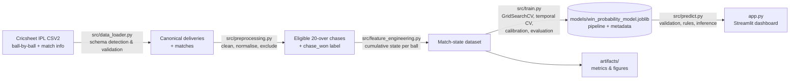
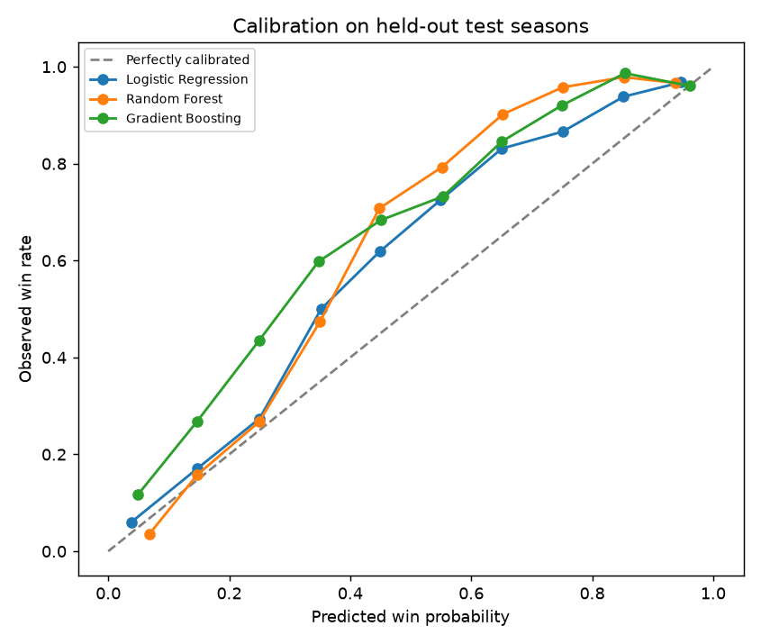

# 🏏 IPL Win Probability Estimator

**ML-powered win-probability estimator for IPL run chases | Python, scikit-learn, NumPy, Pandas, Streamlit**

Pick the batting and bowling teams and the venue, enter the target and the current situation (score, wickets,
overs). The app estimates the chasing team's chance of winning with a model trained on **every ball of 1,185
completed IPL chases (2008–2026)**. You can also explore "what if" scenarios.

> Predictions are statistical estimates, not guarantees. The app is a scenario simulator. It is **not**
> connected to live scores.

---

## Key features

* **Real data, reproducible pipeline.** Free Cricsheet ball-by-ball data, with schema detection and validation
  (Cricsheet CSV2 or Kaggle-style CSVs), name normalisation, and exclusion of ambiguous matches with recorded
  reasons.
* **Leakage-free state dataset.** One training row per delivery of each chase, built only from past deliveries.
* **Honest evaluation.** Chronological match-based test split (latest two seasons), `GridSearchCV` with
  expanding-window season folds, model selection on CV log loss, and a calibration check on out-of-fold
  predictions.
* **Four models compared.** Base-rate baseline, Logistic Regression, Random Forest and Gradient Boosting,
  measured with accuracy, precision, recall, F1, ROC-AUC, log loss, Brier score, ECE, confusion matrix and
  calibration curves.
* **Streamlit dashboard.** Complementary team probabilities, run-rate maths, input validation, completed-match
  handling, what-if charts and a model-information tab.
* **Tested.** 64 pytest tests, covering cricket rules, leakage, edge cases, model loading and a headless
  Streamlit `AppTest`.

## Tech stack

Python 3.11+ (developed on 3.13) · pandas · NumPy · scikit-learn · Matplotlib / Seaborn (EDA and evaluation) ·
Plotly (app charts) · Streamlit · joblib · pytest

## Architecture



### Folder structure

```
IPL-Win-Probability/
├── app.py                         # Streamlit UI (inference only, never retrains)
├── requirements.txt               # runtime dependencies (used by Streamlit Cloud)
├── requirements-dev.txt           # + pytest, notebooks, tabulate
├── .streamlit/config.toml         # theme + headless server settings
├── .env.example                   # optional environment variables (no secrets needed)
├── data/
│   ├── raw/                       # downloaded Cricsheet data (git-ignored)
│   └── processed/                 # cleaned matches, deliveries, chase states, exclusions (git-ignored)
├── models/win_probability_model.joblib   # final model + feature schema + metrics (~5 KB)
├── artifacts/
│   ├── metrics.json, model_comparison.csv, metrics_by_phase.csv
│   ├── figures/                   # calibration, ROC, confusion matrix, importance, win-probability timelines
│   ├── eda/                       # EDA plots + eda_report.md
│   └── run1_baseline_features/    # first training run (before the era feature), kept for transparency
├── notebooks/
│   ├── 01_eda_and_data_preprocessing.ipynb
│   └── 02_model_training_and_evaluation.ipynb
├── src/
│   ├── utils.py                   # paths, constants, team/venue normalisation
│   ├── data_loader.py             # download + schema-aware loading (Cricsheet / Kaggle)
│   ├── preprocessing.py           # cleaning, cricket rules, match exclusion, labels
│   ├── feature_engineering.py     # match-state rows + shared feature derivation
│   ├── train.py                   # GridSearchCV, model comparison, calibration, artifact saving
│   ├── calibration.py             # Platt / isotonic calibration wrapper
│   ├── evaluation.py              # metrics + plots
│   ├── predict.py                 # validation, completed-match rules, inference API
│   ├── app_logic.py               # UI-independent helpers (what-if scenarios, labels)
│   ├── eda.py                     # EDA tables and plots
│   └── synthetic.py               # SYNTHETIC data generator for tests only
├── tests/                         # pytest suite
└── docs/methodology.md            # cricket rules, leakage safeguards, limitations
```

## Dataset

| | |
|---|---|
| Source | [Cricsheet](https://cricsheet.org/downloads/) – "Indian Premier League" CSV2 archive: `https://cricsheet.org/downloads/ipl_male_csv2.zip` |
| Licence | Open Data Commons Attribution License (ODC-By 1.0). Data provided by Cricsheet. |
| Content | 1,243 matches, 295,732 deliveries, IPL 2008–2026 (as downloaded on 2026-10-27) |
| Credentials | None required |

The raw data is **not committed**. To get it:

```powershell
python -m src.data_loader --download     # downloads + extracts into data/raw/cricsheet_ipl_csv2/
```

Alternatively, unzip the archive into `data/raw/cricsheet_ipl_csv2/` yourself, or place a Kaggle-style
`matches.csv` and `deliveries.csv` in `data/raw/`. The loader detects the format and checks the columns. If you
use the Kaggle CLI, keep `kaggle.json` out of the repo (it is git-ignored).

### EDA highlights (real data)

| Item | Value |
|---|---|
| Matches / deliveries | 1,243 / 295,732 (175 super-over deliveries) |
| Seasons | 2008–2026 (19 seasons) |
| Teams / venues after normalisation | 15 / 37 |
| Duplicate deliveries / match ids | 0 / 0 |
| Eligible chases for training | 1,185 |
| Excluded | 58 (23 D/L, 16 super-over ties, 10 reduced-overs, 9 no-results) |
| Chasing-side win rate (eligible) | 54.5% (close to balanced; no resampling needed) |
| Avg first-innings total | ~150–172 in 2008–2022 → 183 (2023), 190 (2024), 189 (2025), 193 (2026) |

See `artifacts/eda/eda_report.md`, the plots in `artifacts/eda/` and notebook 01.

## Methodology

### Preprocessing
* **Team names:** renamed franchises are merged into their current names (Delhi Daredevils → Delhi Capitals,
  Kings XI Punjab → Punjab Kings, Royal Challengers Bangalore → Bengaluru, Rising Pune Supergiants →
  Supergiant). Defunct franchises stay distinct.
* **Venues:** city suffixes are stripped and renamed grounds merged (Feroz Shah Kotla → Arun Jaitley Stadium,
  etc.).
* **Duplicates:** duplicate deliveries and match ids are dropped. **Super overs** (innings 3+) are discarded.
* **Excluded matches:** no-results, super-over ties, D/L and reduced-overs matches, and matches with
  inconsistent metadata. Each exclusion is saved with its reason.

### Feature engineering
Each row is the chase state **after a delivery** (plus the 0/0 starting state), built only from deliveries
bowled so far:

| Feature | Definition |
|---|---|
| `batting_team`, `bowling_team`, `venue` | One-hot encoded (rare or unseen values go to an "infrequent" column) |
| `target` | First-innings total + 1 |
| `current_score`, `wickets_lost`, `balls_bowled` | Cumulative runs (bat + all extras), dismissals (excluding retired hurt), **legal** balls (excluding wides and no-balls) |
| `runs_left` | target − current score |
| `wickets_left` | 10 − wickets lost |
| `balls_left` | 120 − legal balls bowled |
| `current_run_rate` | score × 6 / legal balls (0 before the first ball) |
| `required_run_rate` | runs left × 6 / balls left (clipped at 36) |
| `impact_player_era` | 1 for IPL 2023+ (Impact Player rule), else 0 |

**Target variable:** `chase_won` = 1 if the chasing team won the match. Finished states (target reached, all
out, overs complete) are excluded from training. The app handles them with cricket rules and shows no
probability for them.

### Models and GridSearchCV
All models are scikit-learn `Pipeline`s: a `ColumnTransformer` (`OneHotEncoder` for categories, plus
`StandardScaler` for Logistic Regression) followed by a classifier.

| Model | Grid searched |
|---|---|
| Baseline | Always predicts the training base rate |
| Logistic Regression | `C` ∈ {0.001, 0.003, 0.01, 0.03, 0.1} |
| Random Forest (150 trees) | `max_depth` ∈ {12, 16, None} × `min_samples_leaf` ∈ {100, 250, 500} |
| Gradient Boosting (`HistGradientBoostingClassifier`, 300 iterations) | `learning_rate` ∈ {0.03, 0.08} × `max_leaf_nodes` ∈ {7, 15} × `min_samples_leaf` ∈ {200, 1000} × `l2_regularization` ∈ {1, 10} |

* **Split:** the latest two seasons (2025, 2026) are the test set; 2008–2024 is the training set. The split is
  by match, so no match appears in both.
* **CV:** 4 expanding-window folds, each validating on one season (2021, 2022, 2023, 2024) and training on all
  earlier seasons.
* **Scoring:** `GridSearchCV` refits on **neg log loss** and also records Brier score and ROC-AUC.
* **Selection:** the lowest **CV log loss** wins. The test set is not used for any decision.
* **Calibration:** Platt (sigmoid) and isotonic calibration are compared on out-of-fold CV predictions, with
  each calibrator fitted on earlier folds and scored on the next. One is applied only if it lowers log loss
  by at least 0.002.

## Results

All numbers below were produced by `python -m src.train` on the Cricsheet data downloaded on 2026-10-27.
**Training:** 1,047 matches / 121,979 states (IPL 2008–2024). **Test:** 138 matches / 15,914 states
(IPL 2025–2026), all from seasons later than any training data.

### Model comparison (final run)

| Model | Best params (GridSearchCV) | CV log loss | Test log loss | Test Brier | Test ECE | Test ROC-AUC | Test accuracy | Test F1 |
|---|---|---|---|---|---|---|---|---|
| Baseline (base rate) | – | 0.6949 | 0.6891 | 0.2480 | 0.0388 | 0.500 | 0.559 | 0.718 |
| **Logistic Regression** ✅ | `C=0.001` | **0.4403** | **0.4201** | **0.1351** | **0.0817** | 0.901 | **0.806** | **0.812** |
| Random Forest | `max_depth=16, min_samples_leaf=100` | 0.4556 | 0.4530 | 0.1459 | 0.1152 | **0.903** | 0.783 | 0.775 |
| Gradient Boosting | `lr=0.03, max_leaf_nodes=7, min_samples_leaf=200, l2=10` | 0.4627 | 0.4815 | 0.1547 | 0.1250 | 0.888 | 0.777 | 0.772 |

Selected model: precision 0.884 and recall 0.751 at a 0.5 threshold. The confusion matrix is in
`artifacts/figures/confusion_matrix.png`.

**Why Logistic Regression was selected:** it had the lowest cross-validated log loss (0.440), and this was
decided before the test set was scored. The calibration check on out-of-fold predictions found that neither
sigmoid (0.4460) nor isotonic (0.4524) calibration beat the uncalibrated model (0.4443), so no calibrator is
applied. The model is a 5 KB file, ideal for deployment. On the test seasons it was also the best model by
log loss, Brier score, ECE, accuracy and F1. Random Forest had a fractionally higher ROC-AUC. All models beat
the base-rate baseline by a wide margin.

**Strong regularisation won** for every model (smallest `C`, largest leaves, highest L2). With ~110 highly
correlated rows per match, flexible models can memorise individual matches, so simpler is better here.

### Accuracy by phase of the chase (selected model, test seasons)

| Phase | States | Accuracy | ROC-AUC | Log loss | Brier |
|---|---|---|---|---|---|
| Powerplay (0–6 ov) | 5,199 | 0.713 | 0.841 | 0.572 | 0.192 |
| Middle (6–15 ov) | 7,604 | 0.829 | 0.913 | 0.386 | 0.120 |
| Death (15–20 ov) | 3,111 | 0.904 | 0.965 | 0.252 | 0.076 |

Early in a chase the outcome is genuinely uncertain, so lower accuracy there is expected. A good model should
give cautious probabilities in the powerplay.

### Calibration and what drives predictions



The calibration curves show that every model **still under-estimates how often chasing sides won in
2025–26**: the curves sit above the diagonal in the 0.3–0.8 range. Those seasons had the highest scoring and
chasing success in IPL history (the 2026 chase win rate was 64%). Treat mid-range probabilities as somewhat
conservative for the chasing side.

Permutation importance (`artifacts/figures/feature_importance.png`) is dominated by required run rate, runs
left, wickets and target. Team and venue features have slightly *negative* importance on the test seasons:
franchise identity does not carry over well across seasons. `impact_player_era` shows zero permutation
importance only because every test row has the same value (2025–26 are all in the same era). The flag mainly
changes how the model weighs 2023–24 training data against older seasons.

### Run history (transparency)

| Run | Change | Selected | CV log loss | Test log loss | Test ECE |
|---|---|---|---|---|---|
| 1 | Original features, initial grids | Random Forest + sigmoid calibration | 0.4546 | 0.4236 | 0.0844 |
| 2/3 (final) | + `impact_player_era` feature, wider grids (best params had hit the grid edges) | Logistic Regression | 0.4403 | 0.4201 | 0.0817 |

Run 1 outputs are kept in `artifacts/run1_baseline_features/`. The run 2 changes were motivated by the EDA era
shift *and* by run 1's test calibration, so the final test numbers are slightly optimistic compared with a
truly untouched hold-out. The improvement on held-out data is small; most of the gain shows up in CV.

## Reproduce everything (Windows PowerShell)

```powershell
# 1. Create and activate a virtual environment
py -3 -m venv .venv
.\.venv\Scripts\Activate.ps1
#    If activation is blocked: Set-ExecutionPolicy -Scope CurrentUser RemoteSigned

# 2. Install dependencies
python -m pip install --upgrade pip
pip install -r requirements-dev.txt        # or requirements.txt for app-only

# 3. Get and validate the data
python -m src.data_loader --download

# 4. Preprocess (writes data/processed/)
python -m src.preprocessing

# 5. (Optional) EDA plots + report
python -m src.eda

# 6. Train, tune and evaluate (~3-5 min on a multi-core laptop; --quick for a fast smoke run)
python -m src.train --rebuild-states

# 7. Run the tests
python -m pytest -q

# 8. Launch the app
streamlit run app.py
```

macOS/Linux: use `python3 -m venv .venv` and `source .venv/bin/activate`. Everything else is the same.

To re-run the notebooks: `jupyter nbconvert --to notebook --execute --inplace notebooks/*.ipynb`
(or open them in VS Code with the `.venv` interpreter).

## Example scenarios

Output of the final model (`notebooks/02_model_training_and_evaluation.ipynb`, Impact Player era on):

| Batting (chasing) | Bowling | Venue | Situation | Batting-side win probability |
|---|---|---|---|---|
| Mumbai Indians | Chennai Super Kings | Wankhede Stadium | 96/3 after 11.2 ov, target 181 (need 85 off 52) | **62.0%** |
| Royal Challengers Bengaluru | Kolkata Knight Riders | M Chinnaswamy Stadium | 150/6 after 16 ov, target 210 (need 60 off 24) | **15.3%** |
| Gujarat Titans | Rajasthan Royals | Narendra Modi Stadium | 140/2 after 17 ov, target 165 (need 25 off 18) | **94.0%** |
| Punjab Kings | Delhi Capitals | Arun Jaitley Stadium | 190/5 after 19.3 ov, target 190 | No probability. Shown as "match complete" (target reached). |

```python
from src.predict import WinProbabilityPredictor, MatchState
predictor = WinProbabilityPredictor.load()
r = predictor.predict(MatchState("Mumbai Indians", "Chennai Super Kings", "Wankhede Stadium",
                                 target=181, current_score=96, wickets_lost=3,
                                 overs_completed=11, balls_in_over=2))
print(r.status, r.batting_win_probability, r.bowling_win_probability)
```

## Known limitations

* **Full 20-over chases only.** D/L and reduced-overs matches are excluded, and the app does not model rain
  interruptions.
* **Team identity is a weak signal.** Squads change every season through auctions, so team and venue one-hot
  features add little; permutation importance confirms this.
* **No player, pitch, toss, dew or weather information.**
* **Era shift.** Scoring rose sharply from 2023. The `impact_player_era` flag helps, but only two training
  seasons (2023–2024) represent the current era.
* **Test-set caveat.** The era feature was added after seeing the first run's test-season calibration (see
  `docs/methodology.md`), so the final test numbers are slightly optimistic compared with a completely
  untouched hold-out.
* **Correlated rows.** States within a match are correlated, so the effective sample size is about the number
  of matches (1,047 train / 138 test), not the 138k rows.

## Future improvements

* Point-in-time team strength (e.g. Elo ratings or rolling player ratings), computed without leakage.
* Recent-momentum features (runs and wickets in the last 3–5 overs), with matching app inputs.
* DLS-aware modelling of rain-reduced matches.
* First-innings (projected score) model, so the app also works before the chase starts.
* Optional live-score integration through a licensed data feed.

## Deployment (Streamlit Community Cloud)

The repository is deployment-ready: `app.py` is at the root, `requirements.txt` lists runtime dependencies,
paths are relative to the project root, and the trained model (`models/win_probability_model.joblib`,
~5 KB) is the only artifact the app needs. Raw and processed data are git-ignored, and the app never
needs them. If the model file is missing, the app shows a message explaining how to train it.

1. Push the project to a GitHub repository (the `.gitignore` keeps `.venv/`, data and `.env` out):
   ```powershell
   git init
   git add .
   git commit -m "IPL win probability estimator"
   git branch -M main
   git remote add origin https://github.com/<your-username>/ipl-win-probability-estimator.git
   git push -u origin main
   ```
   Check that `models/win_probability_model.joblib` is included (`git ls-files models`).
2. Go to <https://share.streamlit.io>, sign in with GitHub and click **Create app**.
3. Select the repository, branch `main` and main file path `app.py`. Under **Advanced settings**, choose a
   Python version matching your local one (3.11–3.13).
4. Click **Deploy**. No secrets are required.
5. **After retraining,** commit the new `models/win_probability_model.joblib`. The deployed app picks it up on
   the next reboot or redeploy. Keep scikit-learn's version range the same between training and deployment,
   because joblib models are version-sensitive.

## Acknowledgements

Ball-by-ball data © [Cricsheet](https://cricsheet.org), used under ODC-By 1.0. This project is not affiliated
with the IPL or the BCCI.
